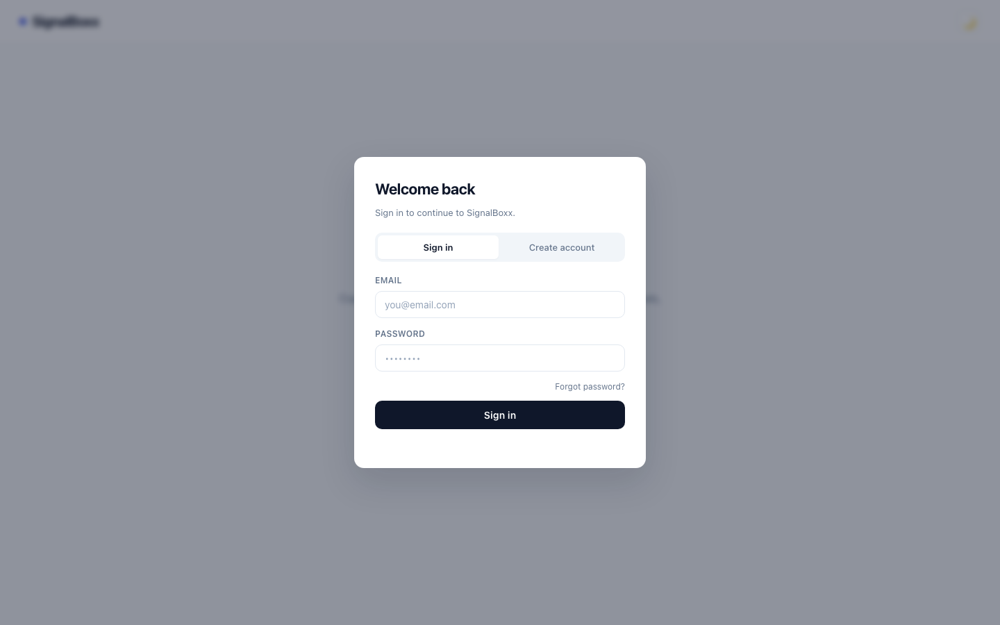
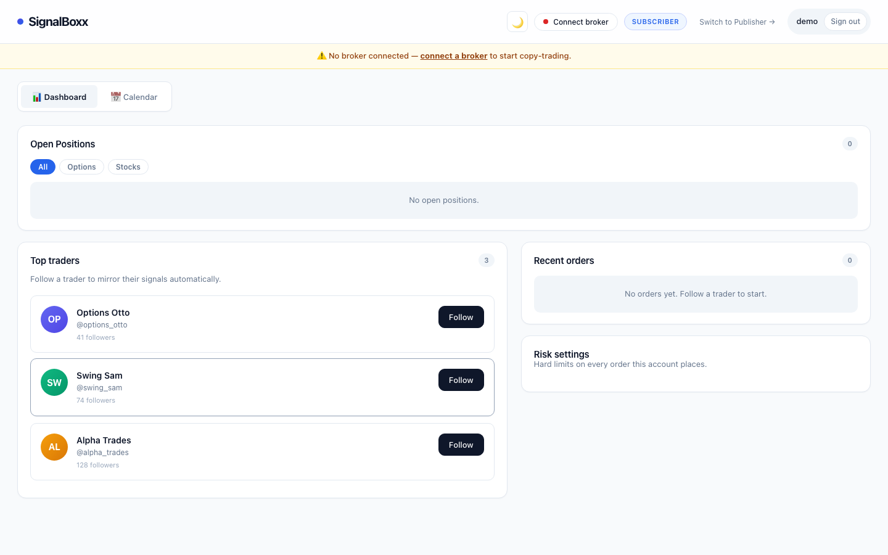

# signalboxx

A Django backend for automated trading signals: it receives/generates trading signals, connects to brokerage accounts, executes orders, and tracks performance.

## Apps

- **users** — accounts, auth (JWT via `djangorestframework-simplejwt`), user preferences.
- **brokers** — brokerage integrations and account linking (Schwab, Webull, SnapTrade).
- **signals** — trading signal models and real-time delivery via Django Channels (WebSockets).
- **execution** — order execution engine and async tasks (Celery).
- **analytics** — P&L calculation and performance reporting.

## Screenshots

| Sign in | Dashboard |
|---|---|
|  |  |

## Stack

- Django + Django REST Framework
- Django Channels + Daphne (ASGI, WebSockets) backed by Redis
- Celery + Redis (background tasks / scheduling)
- PostgreSQL (`psycopg2-binary`) in production, SQLite for local dev
- `django-encrypted-model-fields` for encrypting sensitive DB fields
- Market/broker data via `yfinance`, `snaptrade-python-sdk`, `webull`

## Setup

```bash
python -m venv venv
source venv/bin/activate
pip install -r requirements.txt
```

Create a `.env` file in the project root (see below for required variables), then:

```bash
python manage.py migrate
python manage.py runserver
```

For WebSocket/Channels support and background tasks, you'll also need Redis running locally, and a Celery worker/beat process:

```bash
celery -A signalboxx worker -l info
celery -A signalboxx beat -l info
```

## Environment variables

| Variable | Description |
|---|---|
| `SECRET_KEY` | Django secret key |
| `DEBUG` | `True`/`False` |
| `REDIS_URL` | Redis connection string (Channels + Celery) |
| `FIELD_ENCRYPTION_KEY` | Key for encrypted model fields |
| `SCHWAB_CLIENT_ID` / `SCHWAB_CLIENT_SECRET` / `SCHWAB_REDIRECT_URI` | Schwab OAuth credentials |
| `WEBULL_DEVICE_ID` | Webull device identifier |
| `SNAPTRADE_CLIENT_ID` | SnapTrade client ID |

Never commit `.env` — it's gitignored.

## License

All rights reserved. See [LICENSE](LICENSE).
